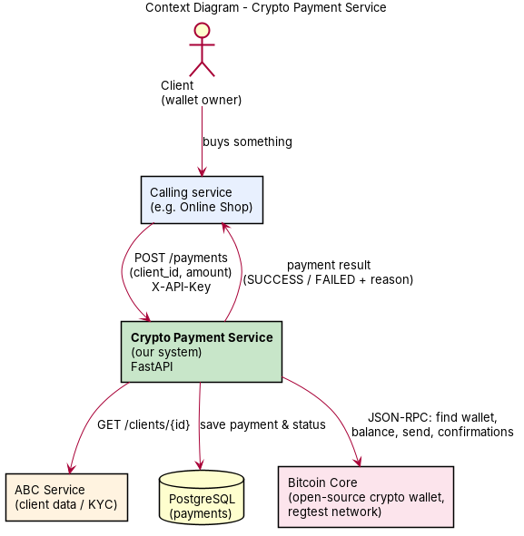
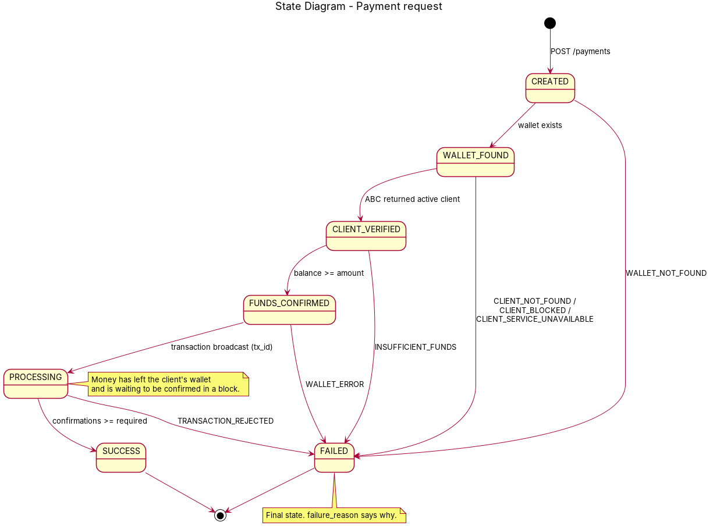

# Crypto Payment Service

A service that other services call to **take a payment from a client's crypto wallet**.
FastAPI + PostgreSQL + **Bitcoin Core** (open-source wallet, regtest) + a mock **ABC** client-data service. Everything runs in Docker.

```
Shop ──POST /payments──▶ Payment Service ──▶ 1. Bitcoin Core: does client have a wallet?
                                          ──▶ 2. ABC: client data (active?)
                                          ──▶ 3. Bitcoin Core: enough balance?
                                          ──▶ 4. Bitcoin Core: send to merchant wallet
      ◀──── SUCCESS / PROCESSING / FAILED + reason
```

- Requirements: [`docs/REQUIREMENTS.md`](docs/REQUIREMENTS.md)
- Architecture, SOLID and defense Q&A: [`docs/ARCHITECTURE.md`](docs/ARCHITECTURE.md)
- Diagrams (PNG + PlantUML source): [`docs/diagrams/`](docs/diagrams)

| Context | State |
|---|---|
|  |  |

---

## Step 1: Run the tests on your laptop (2 min)

```bash
cd crypto-payment-service
python -m venv .venv && source .venv/bin/activate
pip install -r requirements.txt pytest
pytest -q            # expect: 25 passed
```

## Step 2: Run everything locally with Docker (10 min)

```bash
cp .env.example .env          # optionally change the passwords
docker compose up -d --build  # first build downloads Bitcoin Core (~50 MB)
docker compose ps             # all 5 should be "running"

# create wallets + give test BTC to clients 1,2,3 (run once)
docker compose exec api python -m scripts.seed_regtest

# run the demo scenarios
chmod +x scripts/demo.sh
./scripts/demo.sh
```

Open **http://localhost:8000/docs** for Swagger. Each request needs the header `X-API-Key: shop-secret`.

Demo clients:
| client_id | Wallet | Balance | ABC status | Expected result |
|---|---|---|---|---|
| 1 | yes | 5 BTC | ACTIVE | SUCCESS |
| 2 | yes | 0.1 BTC | ACTIVE | INSUFFICIENT_FUNDS if amount > 0.1 |
| 3 | yes | 10 BTC | BLOCKED | CLIENT_BLOCKED |
| 4 | no | – | ACTIVE | WALLET_NOT_FOUND |

Useful commands:
```bash
docker compose logs -f api                      # watch the 4 steps happen
docker compose exec bitcoind bitcoin-cli -regtest -rpcuser=payuser -rpcpassword=change-me-btc \
  -rpcwallet=merchant getbalance                # money arrived at merchant
docker compose down                             # stop (add -v to wipe data)
```

## Step 3: Push to GitHub

```bash
git init && git add . && git commit -m "Crypto payment service - midterm"
gh repo create crypto-payment-service --public --source=. --push
# or create the repo on github.com and:
# git remote add origin https://github.com/<you>/crypto-payment-service.git && git push -u origin main
```
`.env` is in `.gitignore`, so passwords are not pushed.

## Step 4: Deploy to DigitalOcean (20 min)

1. **Create a Droplet:** Ubuntu 24.04, Basic, Regular, **$6/mo (1 GB)** or $12 (2 GB). Add your SSH key. Copy the IP.
   (GitHub Student Pack gives free DigitalOcean credit.)
2. **SSH in and install Docker:**
   ```bash
   ssh root@YOUR_IP
   curl -fsSL https://get.docker.com | sh
   # 1 GB droplet only: add swap so the build doesn't run out of memory
   fallocate -l 2G /swapfile && chmod 600 /swapfile && mkswap /swapfile && swapon /swapfile
   ```
3. **Get the code and start it:**
   ```bash
   git clone https://github.com/<you>/crypto-payment-service.git && cd crypto-payment-service
   cp .env.example .env && nano .env      # change POSTGRES_PASSWORD, BTC_RPC_PASSWORD and the API keys
   docker compose up -d --build
   docker compose exec api python -m scripts.seed_regtest
   ```
4. **Firewall:** only SSH and the API are open.
   ```bash
   ufw allow OpenSSH && ufw allow 8000/tcp && ufw --force enable
   ```
   Docker publishes only port 8000; Bitcoin RPC, Postgres and ABC stay internal.
5. **Test from your laptop:**
   ```bash
   ./scripts/demo.sh http://YOUR_IP:8000
   ```
   Swagger: `http://YOUR_IP:8000/docs`

## Configuration (`.env`)
| Variable | Meaning |
|---|---|
| `WALLET_BACKEND` | `bitcoin` (real Bitcoin Core) or `memory` (fake, no node needed) |
| `REQUIRED_CONFIRMATIONS` | `1` = PROCESSING then SUCCESS after next block; `0` = SUCCESS immediately |
| `CALLER_API_KEYS` | which services may call us, `name:key,name:key` |

## Troubleshooting
| Problem | Fix |
|---|---|
| `WALLET_ERROR` on every payment | Run the seed script; check `docker compose logs bitcoind` |
| Payment stays `PROCESSING` | Check the miner is running: `docker compose logs miner`; the seed script must have created the `miner` wallet |
| `Fee estimation failed` | `-fallbackfee` must be in the bitcoind command (it is in `docker-compose.yml`) |
| Build fails downloading Bitcoin Core | Check the server's internet access; change `BITCOIN_VERSION` in `bitcoind/Dockerfile` |
| DB password error after changing `.env` | `docker compose down -v` (wipes the DB volume) and start again |

## Project structure
```
app/
  api/            routes.py, schemas.py         (HTTP layer)
  services/       payment_service.py            (the 4-step flow)
  domain/         models.py (Payment + state machine), exceptions.py
  ports/          wallet.py, client_data.py, repository.py   (interfaces)
  adapters/       wallets/bitcoin_core.py, wallets/in_memory.py,
                  client_data/abc_http.py, persistence/sql_repository.py
  container.py    wiring (dependency injection)
abc_service/      mock ABC client-data service
bitcoind/         Bitcoin Core Docker image
scripts/          seed_regtest.py, demo.sh
tests/            25 tests (service, Bitcoin adapter, API)
docs/             requirements, architecture/SOLID, diagrams
```
